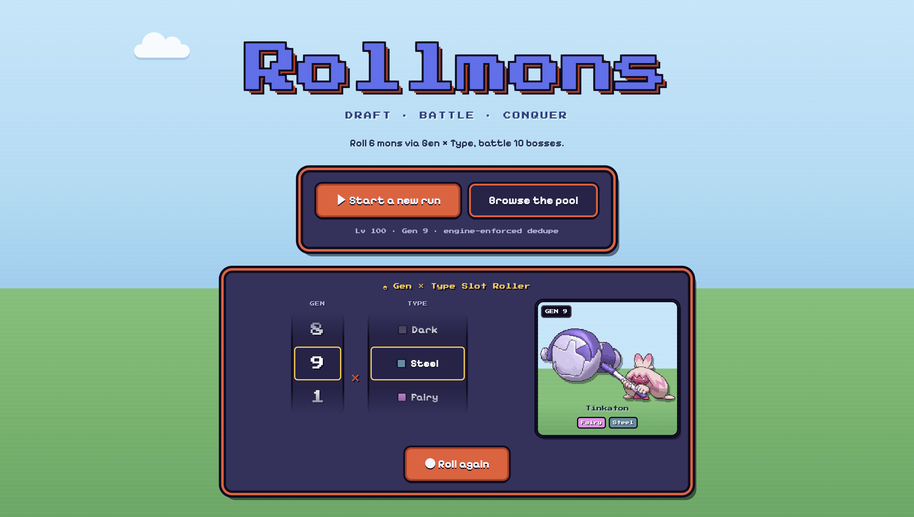
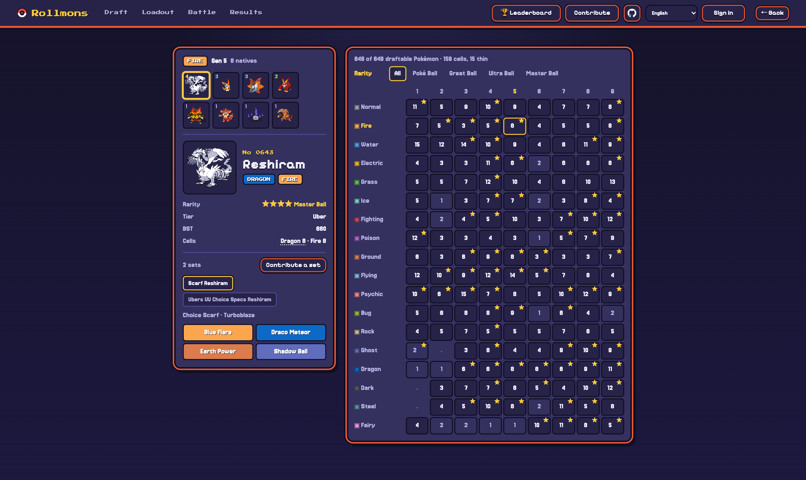
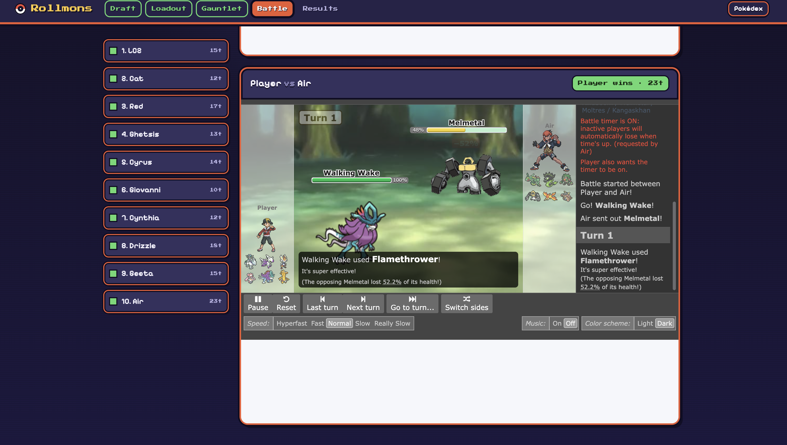
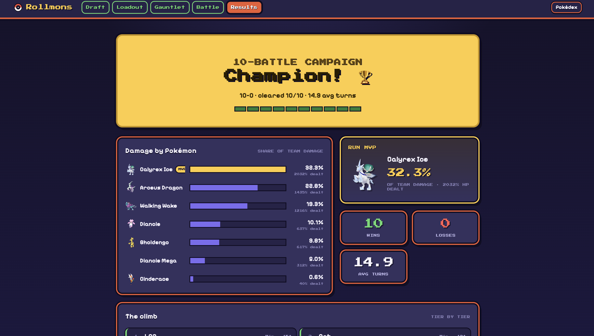

# rollmons

A single-player Pokémon draft/autobattler. Draft six Pokémon through a slot machine, pick each one's set, then watch an AI-piloted ten-battle boss gauntlet.

**v2 goal:** run the whole game in the browser. The battle AI ([poke-engine](https://github.com/pmariglia/poke-engine), Rust) compiles to WebAssembly and [`@pkmn/sim`](https://github.com/pkmn/ps/tree/main/sim) referees in a Web Worker, so there is no battle server and the game hosts as a static site. v1, which ran [foul-play](https://github.com/pmariglia/foul-play) against a local Pokémon Showdown server and shipped as a macOS app, is archived at [ziangit/rollmons](https://github.com/ziangit/rollmons).

## Screenshots (v1 UI, being ported)

| | |
|:--:|:--:|
| <br>**Title & slot roller** | <br>**Draft pool** — 18×9 type-by-debut-generation matrix |
| <br>**Battle theater** | <br>**Results** — outcome, MVP, damage breakdown |

## Status
- Reference Python implementation of the draft, loadout, pool, and results logic with its test suite (`make test`).
- Browser referee spike done: a full gen9 custom-game battle with Mega Evolution runs in-process through `@pkmn/sim`.
- Next: poke-engine wasm build, then the battle worker. See `session-handoff.md`.

## Quick start

```bash
make test      # ruff + pytest for the reference layer (Python 3.11, no Rust/Node)
make harness   # reference draft/loadout UI at http://127.0.0.1:8973 (battles stubbed)
```

## Contributing data
Boss teams (`rollmons/bosses/*.txt`, `rollmons/pool/<tier>/*.txt`) and per-species set overrides (`rollmons/sets/*.txt`) are plain Showdown export text. Validate with:

```bash
.venv/bin/python -m rollmons.validate_submission boss rollmons/pool/advanced/Cynthia.txt
.venv/bin/python -m rollmons.validate_submission set rollmons/sets/abomasnow.txt
```

See `CONTRIBUTING.md`.

## Credits
- [poke-engine](https://github.com/pmariglia/poke-engine) (MIT) — the battle search engine.
- [Pokémon Showdown](https://github.com/smogon/pokemon-showdown) and [`@pkmn`](https://github.com/pkmn/ps) (MIT) — simulator, data, replay player.
- [foul-play](https://github.com/pmariglia/foul-play) (GPL-3.0) — v1's AI client and the design inspiration; no foul-play code is in this repository.
- Pokémon is © Nintendo / Creatures / GAME FREAK. This is a non-commercial fan project.
