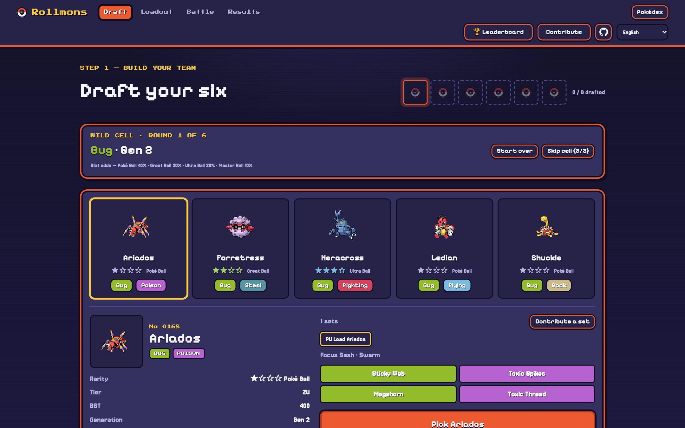
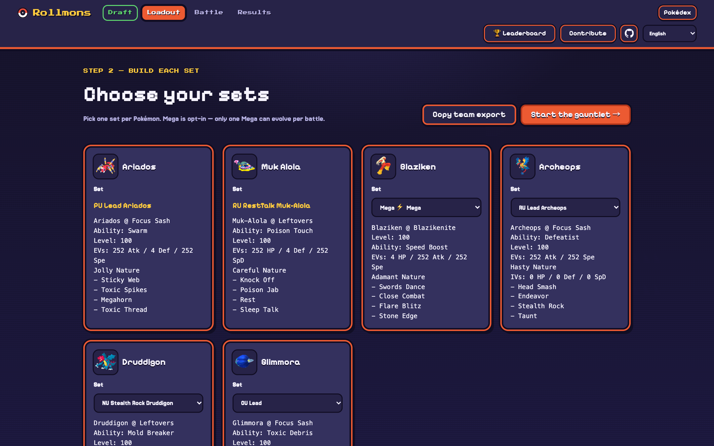
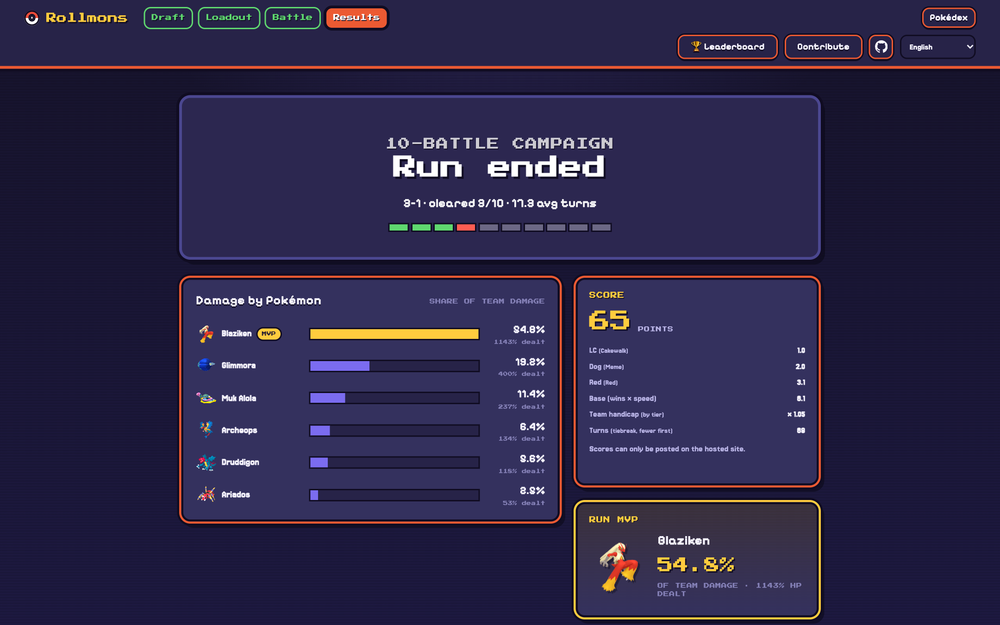

# rollmons

A single-player Pokémon draft autobattler that runs entirely in the browser. Roll six Pokémon through a generation × type slot machine, pick each one's set, then watch an AI pilot your team through a ten-battle boss gauntlet and post the run to a leaderboard.

**Play it:** https://rollmon.vercel.app — no install, no account needed to play (one is needed only to post a score). Works on phones; English, 中文 and 日本語.

**How it is built:** the battle AI is [poke-engine](https://github.com/pmariglia/poke-engine) (Rust) compiled to WebAssembly, and [`@pkmn/sim`](https://github.com/pkmn/ps/tree/main/sim) (Pokémon Showdown's simulator) referees, both in a Web Worker on the player's machine. There is no battle server: the site is static, and the only backend is one small function for accounts, the leaderboard and feedback. v1, which ran [foul-play](https://github.com/pmariglia/foul-play) against a local Showdown server and shipped as a macOS app, is archived at [ziangit/rollmons](https://github.com/ziangit/rollmons); none of its AI client remains here.

## Screenshots

| | |
|:--:|:--:|
| <br>**Title & slot roller** | <br>**Draft** — five candidates per cell, rarity by tier |
| <br>**Loadout** — one set per Pokémon, Mega opt-in | <br>**Pool** — 18×9 type-by-debut-generation matrix |
| <br>**Battle theater** — live replay, bosses revealed one at a time | <br>**Results** — record, damage breakdown, score, MVP |

## How a run works
1. **Draft** — six rounds. Each round locks a cell (type × generation of debut) and offers five candidates; every slot rolls a rarity from the Showdown tier (Poké / Great / Ultra / Master Ball at 40 / 30 / 20 / 10 %), so legendaries are rare but never banned. Thin cells are filled with visitors of the same type from nearby generations; two skips, and Start over.
2. **Loadout** — one set per Pokémon from player-contributed and Smogon analysis sets (over 1,100 sets across ~650 species). Mega Evolution is a set choice.
3. **Gauntlet** — ten hand-built boss teams climbing from a tutorial band to a final wall; the middle bands are drawn at random per run. Both sides are played by the same search AI with full knowledge of both teams, time-boxed per move, so a slow device plays weaker rather than slower.
4. **Results** — replays, damage breakdown and MVP, and a score (band points × speed bonus × tier handicap). Signed-in players post it; the server replays the whole run in the simulator before accepting it and keeps each player's best.

The in-game **? How it works** button tells the same story with the live numbers. Design notes: `docs/PRODUCT.md`, `docs/DIFFICULTY.md`, `docs/BATTLE_AI.md` (what the AI costs the player's machine and how it compares with v1); plan and status: `docs/ROADMAP.md`, `session-handoff.md`.

## Status
- Live at https://rollmon.vercel.app (Vercel; every push to `main` deploys). The game logic (draft, loadout, campaign, score) is TypeScript under `web/`; the Python layer under `rollmons/` remains the reference implementation and test oracle (`make test`).
- Players can contribute from inside the game (**Contribute**: a set for any species, a boss team with the ladder level it fits, or free-text feedback); contributed sets land in `rollmons/sets/`.
- Measured: a desktop core runs ~220k search iterations per 100 ms budget, an iPhone 16 Pro ~85 % of that; a battle costs about 4 s of one core.
- Next: the screen-by-screen UI rework and draft playtesting (`docs/ROADMAP.md`); battle-replay text in the page language is explored but not built.

## Quick start

```bash
make test                      # ruff + pytest for the reference layer (Python 3.11)
cd engine && wasm-pack build --release --target web --out-dir pkg   # engine wasm (rustup + wasm-pack)
cd web && npm install && npm run typecheck && npm test && npm run dev   # game at http://127.0.0.1:8975/dist/index.html
```

See `web/README.md` for the scripts (headless-Chrome full-run check, battle sweeps, name checks).

## Leaderboard setup (Vercel)
The API is one Vercel function (`web/api/`) backed by Neon Postgres. It needs two environment variables (a third, `FEEDBACK_READ_TOKEN`, lets `GET /api/feedback` be read with a bearer token): `DATABASE_URL` (in the Vercel dashboard open the project, **Storage → Create Database → Neon**, free tier, connect it to the project) and `SESSION_SECRET` (any long random string; it signs the account cookies and keys the sign-up address hashes: `openssl rand -base64 48 | vercel env add SESSION_SECRET production`). Then redeploy. The tables are created and migrated on first use (`deploy/leaderboard.sql` documents them). Without the database the API answers 503 and the game hides the board; without the secret accounts are off and scores cannot be posted. Accounts have no email and no password reset; at most 5 can be created per network per day.

## Contributing data
The easiest way is the **Contribute** button in the game. In the repo, boss teams (`rollmons/bosses/*.txt`, `rollmons/pool/<tier>/*.txt`) and per-species set overrides (`rollmons/sets/*.txt`) are plain Showdown export text. Validate with:

```bash
.venv/bin/python -m rollmons.validate_submission boss rollmons/pool/advanced/Cynthia.txt
.venv/bin/python -m rollmons.validate_submission set rollmons/sets/abomasnow.txt
cd web && node scripts/check-names.ts      # every species / move / ability known to the engine
```

See `CONTRIBUTING.md`.

## Credits
- [poke-engine](https://github.com/pmariglia/poke-engine) (MIT) — the battle search engine.
- [Pokémon Showdown](https://github.com/smogon/pokemon-showdown) and [`@pkmn`](https://github.com/pkmn/ps) (MIT) — simulator, data, replay player.
- [foul-play](https://github.com/pmariglia/foul-play) (GPL-3.0) — v1's AI client and the design inspiration; no foul-play code is in this repository (v2's export parser, state mapping and runner were written fresh).
- Pokémon is © Nintendo / Creatures / GAME FREAK. This is a non-commercial fan project.
